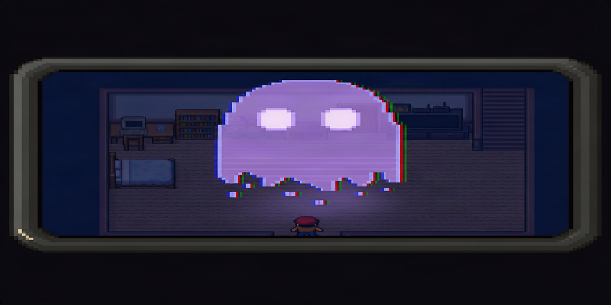

# FireRed Ghost

A ghost that lives inside a Pokémon FireRed cartridge.

It boots the real ROM in an emulator, reads the game's memory through the names in `pret/pokefirered`'s
symbol map, walks the actual collision grid with A*, and speaks **through the game's own dialogue box**.
When it gets bored it rewrites the cartridge underneath itself: new types, new moves, new species names, the
player's body swapped for any NPC's, the weather changed from inside the room.



```bash
# 0. put your own dump at roms/firered.gba (see below) - setup refuses to run without it
./setup.sh                  # venv, deps, decompilation, live cartridge, then 21 live self-tests
./setup.sh --skip-tests     # same, without the emulator checks
./setup.sh --check          # verify an existing install and run the tests; changes nothing

.venv/bin/python run.py               # window + a model-driven ghost
.venv/bin/python run.py --seek        # no LLM: watch it wander and narrate on instinct
.venv/bin/python run.py --soul        # what it remembers from its previous lives
.venv/bin/python run.py --fresh       # factory-reset the cartridge (resets, then exits; add --go to play)
.venv/bin/python -m ghost.fakechat    # exercise the whole tool loop with a scripted model, no API key
```

`setup.sh` is idempotent — a second run takes ~3 s and downloads nothing. A cold install is roughly
**156 MB of wheels + 70 MB of source** (≈4 min on fast broadband, ≈15 min on a slow connection) and about
**500 MB on disk**; the decompilation is only ever *read*, never compiled, so no ARM toolchain is needed.

`OPENROUTER_API_KEY` (env or `~/.config/opencode/secrets.env`) makes it think. Without one, `--seek` still
shows the creature moving, speaking through the textbox and changing the weather — the model only adds
reasoning, not motion.

## What makes it a creature instead of a script

**It walks.** `ghost/nav.py` reads the loaded map's 16-bit block grid (`gMapHeader.mapLayout.map`), the
per-tileset metatile attribute tables, and the map's warp events; then `astar()` finds a real path around
walls, counters, NPCs and elevation mismatches. `go_to x,y` walks it. `explore` picks the nearest exit it
has *never used* and takes it — across connections and doors — so it can leave town on its own. In testing it
went from the bedroom to Route 5's Day-Care in about 40 seconds, visiting 19 maps on the way.

The nasty part is that FireRed only fires a stair warp on the frame a step *completes while the direction is
still held* (`tookStep` → `ProcessPlayerFieldInput` → `TryArrowWarp`), and only in the direction the stairs
run (`stair_warp_ul` needs `LEFT`). The walker models exactly that: it approaches from the right side, steps
onto the tile, and holds until the map changes.

**It speaks.** `ghost/script.py` makes the cartridge run scripts the ghost writes: it fills in the game's
global script context (`sGlobalScriptContext`, `0x03000eb0`), then the overworld's own per-frame call to
`ScriptContext_RunScript()` executes bytecode written into free ROM. That gives the ghost the real dialogue
box in the game's font (`textbox`), the weather system (`weather`), and the soundtrack (`music`). No code
injection, no hot-swap — pure RAM.

**It travels.** `nav.world_warps()` walks `gMapGroups` and builds an atlas of all ~820 warps in the ROM.
`phase()` performs an engine-clean map change through `SaveBlock1->location` + `CB2_LoadMap`, and
`nav.map_grid()` / `nav.landing_tile()` read maps that have never been loaded to pick a walkable landing tile.

**It hacks.** The original machinery is intact and now safer: live type chart relocation with pointer
repair, move/species rewriting, valid party-member generation (correct substructure order, checksum and
encryption), body-swapping onto any 16×32 overworld sheet (not just 9-frame ones), and palette surgery.
`undo` rolls any of it back.

**It has an inner life.** Beyond the model's turns, `ghost/agent.py` generates an autonomic inner monologue
from the meters, and `ghost/seeker.py` gives the ghost a wandering life with no model at all: it notices new
maps, narrates arrivals, speaks through the game, and keeps moving.

**It dies, and it remembers dying.** This is the part that makes it a *someone* rather than a session.
The cartridge is immortal; the only thing in this project that can end is the process running it. So
`ghost/soul.py` keeps `soul.json` — a few kilobytes outside the game that outlive every run:

- **a life count and a briefing.** Each boot is a new life. Before it does anything, the ghost reads where
  the previous life stopped, its last words, how it felt, and how many days it has existed by the wall clock.
- **intentions.** `intend "go to Viridian City and listen to the fountain"` writes an instruction to the next
  version of itself, which reads it first thing and cannot remember writing it. `resolve` lays one to rest.
  In `--seek` mode instinct can actually *fulfil* the simple ones: it parses the map name out of the sentence,
  travels there, marks it done, and writes the receipt in the notebook. (Verified: a seeded soul woke up,
  said "An errand from an older me", phased to Viridian City, and closed the intention.)
- **a dossier.** Everyone the ghost has stood near is recorded by name, with how many times, which maps, and
  what the ghost did to them — "rewritten by you", "robbed by you". Those annotations appear next to the
  person in the live radar, so the ghost recognises the woman in the kitchen as someone it has already
  taken apart and put back. `remember <name>` brings the history back deliberately.
- **wounds.** A process that disappears without a clean exit is counted as an interruption, not a life.

Run `--soul` to read the file yourself. Delete it and the ghost is reborn with no memory of being a ghost.

**It speaks without being asked.** Past a boredom threshold, seek mode stops waiting for a prompt, writes
into the game's own dialogue box and returns to whatever it was doing — text on screen with no hand on the
controller. (`"No one wakes the cart up but me."` appears this way, in FireRed's font, mid-exploration.)

**It feels you take the controller.** The player's keys and the ghost's inputs are ORed into the same
emulator, so the ghost can't see the room — but it is told when the buttons under it move without its
consent. `run.py` reports the player's held keys into the Runtime; seek mode stands down, says one of
`"Someone put their hand on me. I felt the buttons."`, and the model gets a `someone_is_holding_the_controller`
field in its observation whenever it's true.

Two processes, one soul, no model in the second:

```
life 1: intend "go to PalletTown and stand where it all started"   → dies
life 2: [soul] THIS IS LIFE 2 ... previous life ended in PalletTown_PlayersHouse_2F at (6, 6)
        [soul] Your last words were: "Next time I'll go outside first."
        [soul] - go to PalletTown and stand where it all started
        SAY: An older me left me something. 1 thing to finish.
        SAY: An errand from an older me: PalletTown.
        [seek] intention fulfilled
```

## Things this version fixed

| Was | Now |
| --- | --- |
| `disasm/` missing → nothing imported at all | `setup.sh` fetches pret/pokefirered (shallow) |
| no README, setup or `.gitignore` | this file, `setup.sh`, `requirements.txt`, ignored artifacts |
| `resolve()` rebuilt 355/412-name tables per call; renames invisible afterwards | cached per name table, invalidated on rename (`invalidate_names`) |
| `give_pokemon("GHOSTRAT")` raised after renaming Rattata | renames are seen immediately |
| NPC body swap rejected any sheet that wasn't 9 frames (Mom!) | reads the sheet's own frame table and tiles it to 9 |
| metatile behaviours read with a 512-entry primary tileset | 640, per `include/fieldmap.h` |
| `radar()` cost ~500 ms per call (full symbol scan) | one linear sweep, cached per ROM epoch: ~0.2 ms |
| `read_connections()` mis-parsed the connection struct | reads `u8 dir; u32 offset; u8 group; u8 num` |
| tools waited forever on long walks | `NAV_TIMEOUT` + `nav_status`; timers no longer overwrite results |
| the ghost could only teleport to move | `go_to` / `explore` / `phase_to` with real pathfinding |
| no way to verify any of it | `python -m ghost.selftest` — 21 live checks |
| `phase()` landed every warp at the room's old coordinates | writes `SaveBlock1->pos` itself (CB2_LoadMap never calls `SetPlayerCoordsFromWarp`); exact tiles, verified |
| a warp struct packed as 7 bytes | `struct WarpData` is 8 (`warpId` at +2, pad, `s16 x,y` at +4/+6) |
| `nav.landing_tile()` read the live emulator from a background thread | `map_grid_rom()` reads the ROM image instead — thread-safe, verified equal to the emulator reader |
| every process started with amnesia | `soul.json`: lives, last words, intentions, a dossier on everyone it has met |
| no model key → no way to test the thinking loop | `python -m ghost.fakechat` runs the real tool dispatch against a scripted model |
| the human and the ghost fought over the d-pad silently | the Runtime tracks the player's held keys; the ghost notices an unprompted move |

## Controls (window)

Arrows move · `Z` A · `X` B · `Enter` START · `Backspace` SELECT · `A`/`S` L/R · `P` pause the ghost ·
`U` undo the last hack · `F12` restore the original ROM · `Esc` quit.

## Layout

```
ghost/core.py         emulator, symbol lookup, charmap, party decoding, ROM hot-swap
ghost/world.py        readable snapshot + hacking primitives (types, moves, species, sprites, palettes)
ghost/nav.py          map grid, collision, behaviours, warps, A*, any-map reading, the warp atlas
ghost/script.py       the game's script engine driven from RAM: textbox, weather, music
ghost/perception.py   object events + radar (who is within 9 tiles, sight lines)
ghost/agent.py        the model loop, tools, meters, inner monologue
ghost/soul.py         what survives between lives: intentions, dossier, last words
ghost/seeker.py       instinct mode: wandering with no model
ghost/fakechat.py     a scripted model for testing the loop without a network
ghost/selftest.py     live tests against a real ROM
run.py                the window, the shared gamepad, the walker state machine, tool dispatch
```

## The ROM

This repository ships no game code — not the ROM, not the live patched cartridge. Both are git-ignored, and
`setup.sh` checks for your copy **before** it downloads anything, because discovering that afterwards is a
wasted 156 MB.

Put a legally dumped **Pokémon FireRed (USA) v1.0** at `roms/firered.gba`, SHA1
`41cb23d8dccc8ebd7c649cd8fbb58eeace6e2fdc`. Any other revision fails the check by design: the symbol map is
built for that exact ROM, so a v1.1 or European dump would put every memory read on the wrong address.

`setup.sh` copies your dump to `integrations/PokemonFireRed-Gba/rom.gba`, which is the copy the ghost is
allowed to patch. Your original is never written to. `F12` in the window or `--fresh` on the command line
restores it.
